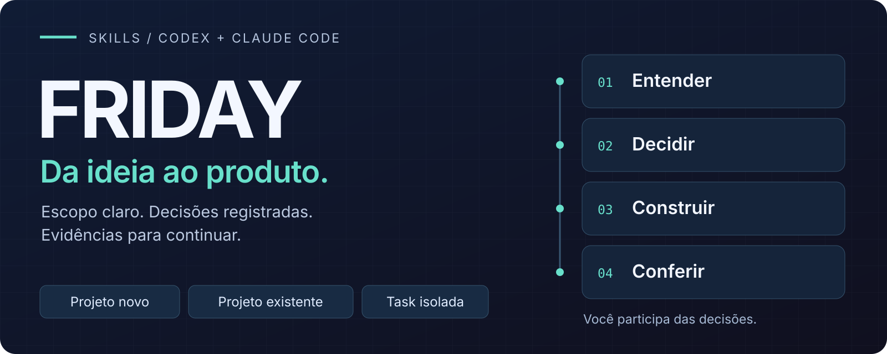
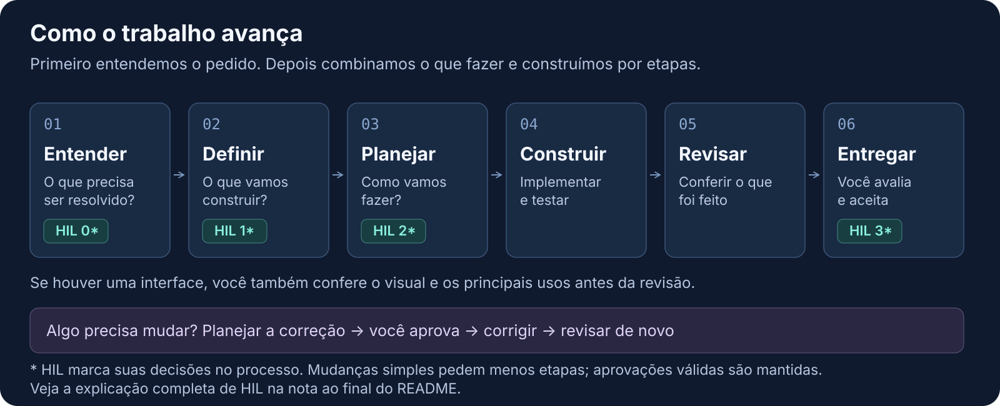

<p align="center">
  
</p>

# FRIDAY

**Da ideia ao produto, uma etapa de cada vez.**

FRIDAY é um kit de skills para **Codex e Claude Code** que organiza o trabalho com agentes de IA: entender o problema, definir o que construir, planejar, executar, revisar e conferir o resultado com você.

Você traz uma ideia, um projeto em andamento ou uma task. Antes de construir, o agente ajuda a definir o que precisa ser feito e como conferir se deu certo: é o **desenvolvimento guiado por especificações (`SDD`)**. Você participa das decisões ao longo do caminho (`HIL`<sup><a href="#nota-hil">*</a></sup>). O planejamento acompanha o tamanho e o risco da mudança, e as decisões ficam no repositório para o trabalho continuar na próxima sessão.

<p align="center">
  <a href="#projeto-do-zero"><strong>PROJETO DO ZERO</strong></a>
  &nbsp; · &nbsp;
  <a href="#projeto-existente">PROJETO EXISTENTE</a>
  &nbsp; · &nbsp;
  <a href="#uma-unica-task">UMA ÚNICA TASK</a>
  &nbsp; · &nbsp;
  <a href="#estado-e-documentacao">ESTADO E DOCUMENTAÇÃO</a>
</p>

> **Na bancada:** o conteúdo das 19 skills existe para os dois clientes. A validação real está em andamento no Codex; Claude Code ainda está pendente. Os exemplos abaixo explicam os contratos atuais e não representam cenários de aplicação já testados. O instalador está planejado. [Estado e limites](docs/plans/EXECUTION-STATE.md#client-validation-status).

## 00 / Escolha por onde entrar

| Seu cenário | Comece aqui | Resultado esperado pelo contrato |
| --- | --- | --- |
| Tenho uma ideia e quero começar do zero | [Projeto novo](#projeto-do-zero) | Produto definido, plano aprovado e fundação mínima verificada |
| Já tenho um projeto e quero adotar o fluxo | [Projeto existente](#projeto-existente) | Diagnóstico, reaproveitamento das convenções e adoção delimitada |
| Tenho uma task pronta e autorizada | [Task isolada](#uma-unica-task) | Mudança no escopo atribuído, checks e handoff |
| Quero corrigir algo, mas ainda não tenho plano | [Pedido novo de mudança](#pedido-novo-de-mudanca) | Triagem e contrato proporcional antes de executar |
| Preciso continuar em outra sessão | [Retomada](#retomar-o-trabalho) | Estado reconciliado, decisões preservadas e próxima ação |

**Nesta página:** [Preparação](#preparar-o-cliente) · [Exemplos](#exemplos-de-uso) · [Fluxo e decisões](#fluxo-e-decisoes) · [Skills e contexto](#skills-e-contexto) · [Documentação](#estado-e-documentacao).

<a id="preparar-o-cliente"></a>

## 01 / Prepare o cliente

Abra Codex ou Claude Code na raiz do **projeto em que você vai trabalhar**, com acesso aos arquivos e às ferramentas necessárias à tarefa. As skills são instruções com referências e templates; os comandos de validação vêm do projeto consumidor.

O conteúdo está separado por cliente. Para experimentar a cópia manual por projeto, use o adapter correspondente:

| Cliente | Origem neste kit | Destino no projeto consumidor | Seleção explícita prevista no adapter |
| --- | --- | --- | --- |
| Codex | [skills/adapters/codex](skills/adapters/codex) | `.agents/skills/<skill-name>/` | `$friday-flow` |
| Claude Code | [skills/adapters/claude-code](skills/adapters/claude-code) | `.claude/skills/<skill-name>/` | `/friday-flow` |

Copie cada pasta de skill **inteira**, incluindo seus recursos e avisos. Para explorar todos os exemplos, disponibilize as 19 pastas do adapter escolhido. Preserve conteúdo manual e resolva colisões antes de copiar. Depois, confira no cliente se as skills aparecem e se ele consegue ler seus recursos. Essa preparação manual ainda não equivale a suporte validado nas duas ferramentas.

Os prompts abaixo usam linguagem natural, prevista nos dois adapters. Se o cliente não descobrir uma skill, registre a pendência antes de seguir. O [catálogo](skills/core/catalog.md) detalha quais capacidades cada ramo requer; uma fonte existente e válida pode dispensar recriar a etapa que a produziu.

<a id="exemplos-de-uso"></a>

## 02 / Coloque o fluxo para trabalhar

Os nomes, paths e produtos dos exemplos são ilustrativos. Substitua pelo seu caso. Os textos são pedidos para colar **na conversa com o agente**, depois de disponibilizar as skills.

<a id="projeto-do-zero"></a>

### Começar um projeto do zero

Abra o diretório de destino e descreva problema, público, recorte e restrições:

```text
Use friday-flow para conduzir um projeto novo neste diretório.

Projeto: uma agenda web para uma oficina de bicicletas. O atendente cadastra
clientes e bicicletas, agenda serviços e acompanha o status de cada ordem.
O primeiro recorte é o agendamento; pagamentos ficam para outra entrega.

Inspecione o diretório e proponha o nível de processo. Esclareça o que faltar
para definir o produto e prepare as decisões de produto, solução e execução.
Depois das aprovações pertinentes, use friday-bootstrap para construir apenas
a fundação mínima autorizada, verificar o resultado e indicar a próxima task.
```

**Caminho esperado:** triagem → descoberta/recorte quando necessários → produto → solução e tarefas → bootstrap autorizado → revisão e aceite. O bootstrap entrega a base; as funcionalidades seguintes seguem em tarefas próprias.

A stack acompanha o produto. Para web sem base de componentes, a preferência é Mantine + styled-components, com React Hook Form e Zod nos formulários. Se a direção visual ainda não existir, a aparência é provisória, coerente e limitada ao recorte. Expo/React Native e Kotlin/Android têm perfis separados. [Perfis técnicos](docs/research/TECHNICAL-PROFILES.md).

<a id="projeto-existente"></a>

### Trabalhar em um projeto existente

Abra a raiz da aplicação. Comece com um diagnóstico que use o código e os documentos atuais:

```text
Use friday-flow e friday-adopt para preparar a adoção do FRIDAY neste projeto.

Já temos uma aplicação de atendimento em produção. A primeira melhoria é
filtrar chamados por responsável e status, usando a UI existente. Inspecione
instruções, arquitetura, testes, comandos, documentos e mudanças locais.

Reaproveite as convenções existentes e mapeie onde ficarão os artefatos do
fluxo. Apresente as lacunas e um patch de adoção pequeno, com arquivos,
efeitos, reversão e validação, para eu avaliar antes de aplicar.
Depois da adoção autorizada, conduza a melhoria por especificação, plano,
execução, revisão e aceite, respeitando as decisões pertinentes.
```

**Caminho esperado:** inventário → mapa dos documentos canônicos → proposta concreta → adoção autorizada e verificada → melhoria pelo fluxo de produto, solução, execução, revisão e aceite. O diagnóstico preserva stack, componentes, arquivos manuais e mudanças em andamento. Alterações em instruções ou configurações entram no patch apresentado.

Depois da adoção, uma melhoria pode entrar pelo mesmo `friday-flow`, com seu objetivo e critérios de aceite. A existência do projeto permite reutilizar fontes válidas e reduzir o trabalho de especificação.

<a id="uma-unica-task"></a>

### Executar uma única task

Use esta entrada quando a task já tiver **contrato, dependências satisfeitas e autorização válida**. Informe o ID e o documento exatos do seu projeto:

```text
Use friday-execute-task para executar somente T-03, descrita em
docs/plans/active/T-03.md deste projeto.

Confira o contrato, as fontes atuais, as dependências e a autorização
registrada. Implemente o escopo atribuído, preserve alterações preexistentes
e execute os checks pertinentes. Registre o resultado, as limitações e o
handoff na task para integração pelo coordenador.
```

**Resultado esperado:** arquivos atribuídos alterados, evidências por critério e handoff. Essa skill executa a unidade; a coordenação do plano, a revisão e o aceite da entrega continuam nas respectivas etapas. Se a fonte ou a autorização estiver ausente, a unidade fica pendente com o motivo registrado.

<a id="pedido-novo-de-mudanca"></a>

### Resolver um pedido que ainda não virou task

Para um bug ou melhoria recém-chegados, entre pela triagem:

```text
Use friday-flow para tratar este bug: ao salvar o cadastro de cliente com
telefone vazio, a tela mostra um erro genérico. O telefone é opcional.
Quero salvar sem telefone e manter a validação dos demais campos.

Inspecione o caso, proponha o nível de processo e prepare um contrato
proporcional com critérios de aceite e verificação antes da implementação.
```

O tamanho aparente do pedido é um sinal; contratos públicos, dados e riscos também entram na escolha do processo.

<a id="fluxo-e-decisoes"></a>

## 03 / Decida o caminho, acompanhe a entrega

<p align="center">
  
</p>

Primeiro, o agente entende o pedido e sugere quanto planejamento ele precisa. Em seguida, vocês combinam o que será construído e como fazer. Com esse caminho aprovado, o agente implementa, testa e prepara a entrega para revisão e para você avaliar o resultado.

Nos momentos de decisão, o agente apresenta uma proposta com opções, consequências e uma recomendação. Você pode aprovar ou pedir ajustes. **O que já foi aprovado continua valendo enquanto a proposta e o alcance do trabalho permanecerem os mesmos.** Se algo importante mudar, a decisão é retomada na parte afetada.

| Nível | Como o trabalho é organizado |
| --- | --- |
| `focused` | Para uma mudança pequena, clara e fácil de reverter: plano curto e verificações proporcionais |
| `lean` | Para uma mudança limitada que pede mais planejamento: descrição do que fazer, solução e tarefas resumidas; você pode aprovar o que construir e como executar em uma decisão |
| `complete` | Para mudanças com mais risco ou decisões importantes em aberto: requisitos no PRD, solução na TechSpec e tarefas com suas dependências |
| `concept-design` | Para quando ainda precisamos explorar a ideia ou comparar caminhos: acrescenta essa descoberta e avaliações de produto e solução ao fluxo completo |

Os marcadores **HIL 0 a 3**<sup><a href="#nota-hil">*</a></sup> no desenho mostram essas decisões: quanto planejar, o que construir, como executar e se o resultado pode ser aceito. O formato das aprovações acompanha o nível escolhido. A [referência de HIL](skills/core/references/hil.md) explica os critérios e as decisões adicionais para cada caso.

Na revisão, a entrega é comparada com o que foi combinado e com os resultados dos testes. Se houver problemas, o agente prepara as correções para aprovação, aplica o que foi autorizado e encaminha para uma nova revisão independente. Depois, você avalia a entrega e dá o aceite final. Quando houver uma interface, você também confere o visual e os principais usos antes da revisão geral.

<a id="skills-e-contexto"></a>

## 04 / Use a peça certa e preserve o contexto

`friday-flow` coordena as etapas. As outras skills têm responsabilidades próprias, para trabalhar no fluxo ou produzir um artefato isolado:

| Objetivo | Skills |
| --- | --- |
| Entender e recortar | `friday-triage`, `friday-discover`, `friday-plan-product` |
| Criar ou adotar a base | `friday-bootstrap`, `friday-adopt` |
| Especificar e planejar | `friday-specify-product`, `friday-design-solution`, `friday-review-design`, `friday-plan-tasks` |
| Executar | `friday-run-tasks`, `friday-execute-task` |
| Revisar e corrigir | `friday-review`, `friday-plan-fixes`, `friday-apply-fixes` |
| Planejar manutenção | `friday-plan-refactor`, `friday-plan-remediation` |
| Salvar contexto e aceitar | `friday-checkpoint`, `friday-accept` |

O [catálogo completo](skills/core/catalog.md) liga cada ID ao contrato, às entradas, às saídas e às dependências. O núcleo compartilhado mantém esses contratos, referências e templates; cada adapter leva os recursos locais necessários à skill. As instruções carregam o apoio conforme a etapa. Jira e ferramentas externas são condicionais.

<a id="retomar-o-trabalho"></a>

### Retomar o trabalho

Na nova sessão, abra o mesmo projeto e identifique a entrega:

```text
Use friday-flow para retomar a entrega de agendamento da oficina.
Localize o plano e as decisões no repositório, confira os arquivos atuais
e reconcilie o checkpoint com as fontes. Preserve autorizações válidas,
informe pendências e continue pela próxima ação autorizada.
```

Especificações, planos concluídos, decisões e evidências permanecem versionáveis no projeto. O checkpoint ajuda a localizar o trabalho; código, testes e documentação durável atual estabelecem o comportamento implementado. [Estado e recuperação](skills/core/references/state-and-recovery.md).

<a id="estado-e-documentacao"></a>

## 05 / O que está disponível hoje

O repositório contém **19 contratos, 19 entradas por cliente, referências, templates e avisos de licença**, com verificações estáticas de metadata, paridade e recursos locais. A [validação em clientes reais](docs/plans/EXECUTION-STATE.md#client-validation-status) está em andamento: há evidência amostrada no Codex, incluindo fluxo documental e descoberta, com falhas e lacunas registradas. Claude Code permanece pendente.

Os cenários de aplicação desta página são exemplos de uso dos contratos. Perfis técnicos práticos e a matriz de plataformas ainda precisam de validação própria. O [instalador para Windows, macOS e Linux](installer/README.md) está planejado; comandos de instalação serão publicados depois de implementados e verificados.

| Documento | O que você encontra |
| --- | --- |
| [Skills](skills/README.md) e [catálogo](skills/core/catalog.md) | Organização, contratos e dependências |
| [Especificação do kit](docs/research/KIT-SPECIFICATION.md) | Desenho aprovado e sequência de implementação |
| [Fontes e definições](docs/research/SOURCES.md) | Decisões, referências e perfis condicionais |
| [Verificações de conteúdo](docs/validation/FRIDAY-004-content-checks.md) | Evidências estáticas e seus limites |
| [Validação dos clientes](docs/plans/EXECUTION-STATE.md#client-validation-status) | Resumo do andamento e limitações; relatório detalhado em preparação separada |
| [Estado de execução](docs/plans/EXECUTION-STATE.md) | Progresso durável e próxima etapa |

## Bases e licença

O [vibe-coding-toolkit](https://github.com/soumatheusgomes/vibe-coding-toolkit) inspira descoberta, planejamento e bootstrap, além da organização visual deste README. O [agents-instructions](https://github.com/ColibriAgile/agents-instructions) fornece a base de SDD, HIL, revisão e retomada.

Conteúdo próprio sob [MIT](LICENSE), preservando os avisos das bases adaptadas. A [proveniência por arquivo](docs/research/CONTENT-PROVENANCE.md) registra as origens do kit. As imagens desta página são diagramas próprios; a [referência editorial](docs/assets/readme/README.md) registra a revisão consultada e os limites da adaptação.

## Por que FRIDAY?

O nome homenageia a **F.R.I.D.A.Y.**, IA do Tony Stark que substitui J.A.R.V.I.S. no cinema. A expansão **Female Replacement Intelligent Digital Assistant Youth** é associada à variante de **Avengers Campus**.

Também remete a “girl Friday”: um braço direito para tarefas variadas. A origem literária está em Sexta-Feira, de *Robinson Crusoé*, de Daniel Defoe (**1719**); as expressões inglesas surgiram depois. As [fontes da homenagem](docs/research/SOURCES.md#fontes-da-homenagem) detalham essas referências e suas ressalvas.

<a id="nota-hil"></a>

\* **HIL — Human-in-the-Loop** é uma forma de trabalhar em que a IA executa tarefas e uma pessoa aprova as decisões que orientam o trabalho. Quando precisa dessa decisão, o agente apresenta uma proposta concreta, explica as opções e aguarda sua resposta antes de executar a parte que depende dela.

**Exemplo:** na agenda da oficina, você aprova que a primeira entrega terá agendamentos, sem pagamentos. O agente apresenta a solução e as tarefas para construir esse recorte. Com sua aprovação, implementa e verifica. Após a revisão, mostra o resultado e as limitações para você aceitar ou pedir ajustes.

No FRIDAY, HIL 0 define quanto planejar; HIL 1 aprova o que construir; HIL 2 aprova a solução e sua execução; HIL 3 aceita a entrega revisada. O nível escolhido organiza essas decisões. Dentro do conteúdo e escopo já aprovados, o agente resolve os detalhes e segue trabalhando.
